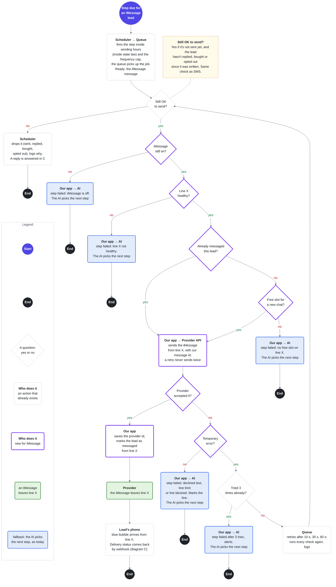

# iMessage: two flow diagrams

Back to the plan: [README.md](README.md)

**Why B and C:** messages leave a number and replies come back only in these two, so most failures happen here. Number health (D) is checked inside them too. A is manual in v1.

**Where this sits in Outcraft's flow:** lead joins a campaign → before each iMessage step, the **iMessage check** → the AI writes the step's message, by iMessage if the lead passed → scheduler: step is due → **B**, only for leads who passed: send-time checks, then iMessage from line X, or back to the AI → **C:** statuses and replies → AI answers and picks the next step. Leads who can't get iMessage get the campaign as usual.

**How to read:**
- 🟣 start (what triggers it) · ⚫ end, one per branch · ◇ a question, with yes and no arrows · ▢ an action, **bold** = who does it · 🟩 an iMessage leaves line X · 🟦 fallback: the AI picks the next step, as today, never from line X · 🟪 purple border: new for iMessage; grey border: already exists, shared with SMS · 🟨 dashed yellow: a note on a question
- **Fallback** (🟦 blue boxes): when iMessage can't go, our app tells the AI that the step failed, and why, as a failed SMS does today. The AI picks the next step, as today, from the campaign's other channels: often SMS from the store's own number, sometimes a call. It never picks iMessage again for this lead in this campaign. Mid-chat, it says it's the same store, because the number changes. If the lead has no other text channel they agreed to, a person gets the chat instead.
- **Who does it:** our app, the scheduler, the queue, the AI, the provider, or the lead's phone.
- **Line X** is the store's iMessage line: one per store in v1, like its one SMS number. Every iMessage to the store's leads comes from it. It starts at most 10 new chats a day, then 25, then 50 as it warms up, and 15 an hour.
- **Number health:** every failure, opt-out and provider warning updates line X's health. Weak: half the new chats, and a Slack alert. Blocked: no new chats, and Slack and the store are told (C1).
- **"Still OK to send?"** (B and C2): the campaign's shared check, the same one SMS uses, run again right before sending. Yes only if the message hasn't gone out yet, and since the AI wrote it, the lead hasn't replied, bought or opted out. If not, the message is dropped and logged.
- **iMessage switches:** one for everyone on Outcraft (our team, or the circuit breaker when the provider is down), one per store (our admins), one per campaign. All three must be on.
- **Which steps:** iMessage is a fifth channel. In a campaign with iMessage on, a lead who passed the check gets text steps by iMessage instead of SMS. So a lead never gets SMS and iMessage from two numbers. After a fallback, the lead's next steps run as usual.
- **What B leaves to the existing system:** sending hours, state legal hours and the frequency cap (the scheduler fires the step inside them), and the "Still OK to send?" check. B adds only the iMessage on-switch and line X's limits.
- **Legal hours in C:** live replies skip the scheduler, so C checks legal hours itself, with the same rule. It checks before the AI writes, so no answer waits for hours and goes out stale.
- **Checks in two places:** the full iMessage check runs before writing. At send time, the campaign's shared check and the on-switch run again, so nothing stale goes out. If the check, or the lookup, fails, the lead gets the campaign as usual.
- **When iMessage fails:** if we know it didn't arrive (refused, failed, not on iMessage), the AI picks the next step at once. If we don't know (no delivery status in 15 min), we don't resend, so the lead never gets both. The lead is marked, and the next steps run as usual. A late "delivered" clears the mark.
- **No double sends:** every send carries our message id, so a retry after a timeout never reaches the lead twice.
- **A person takes over:** the AI stays quiet and the typing dots stop. If nobody answers within 1 hour, the AI sends one short holding message, inside legal hours: "Someone from the store will reply soon."
- **The call after a text:** their default sequence calls about 3 minutes after a text step. That stays. If the lead replies first, the reply cancels scheduled steps, including that call (diagram C).
- **Logging:** every refusal, retry, fallback and drop is logged with its reason and the provider's error key.

---

## B. Sending a message: a step is due for an iMessage lead, up to the message leaving a number (or not)

**Before B, when the AI writes the step** (not drawn, it's one check):
1. **iMessage check** (joins today's channel check if there is one): iMessage on for the store and the campaign, a US/CA number, texting consent, not opted out, passes Do Not Call, not in FL, MD or OK during the pilot, the lookup says iMessage (cached 30 days), the iMessage group of the pilot, no fallback earlier in this campaign, and fewer than 2 unanswered iMessages. Any error, timeout or unknown means no.
2. **The AI writes the step's message,** one message as today. For an iMessage lead, it's a short question with no link until the lead has written to our line, then the full message. If the iMessage fails, the AI writes the next step then.
3. **It passes our content check,** or the AI rewrites it once. Still failing: nothing is sent, and the team is alerted.

**Leads who fail the check** (Android, no consent, outside the pilot group) get the campaign as usual. Their steps never enter B.

🟣 start (what triggers it) · ⚫ end, one per branch · ◇ a question, with yes and no arrows · ▢ an action, **bold** = who does it · 🟩 an iMessage leaves line X · 🟦 fallback: the AI picks the next step, as today, never from line X · 🟪 purple border: new for iMessage; grey border: already exists, shared with SMS · 🟨 dashed yellow: a note on a question

If the diagram doesn't render: [diagram-b.png](diagram-b.png)

---

## C. Provider webhooks: statuses and a lead's reply, up to the AI's answer going out

**Before C1 and C2, for every event** (not drawn, as for SMS): our app checks the webhook's signature, so a fake one is rejected; skips an event it has already seen; saves the event, answers "OK" fast and puts it on the queue. Then **C1** handles delivery statuses, and **C2** handles a lead's reply. C2 runs the same shared check as B before any answer goes out. Every 5 minutes, a catch-up job pulls events we missed and finds messages with no status after 15 minutes.

```mermaid
%%{init: {"theme": "base", "themeVariables": {"fontFamily": "Helvetica, Arial, sans-serif", "primaryColor": "#ffffff", "primaryBorderColor": "#d0d4db", "primaryTextColor": "#1f2328", "lineColor": "#6b7280", "edgeLabelBackground": "#ffffff"}, "themeCSS": "foreignObject { overflow: visible; } .nodeLabel { white-space: nowrap; } .cluster-label .nodeLabel { font-size: 20px; font-weight: 600; color: #374151; }", "flowchart": {"curve": "basis", "nodeSpacing": 40, "rankSpacing": 45, "padding": 18}}}%%
flowchart TD
        S2(("<b>Every 5 min:<br/>catch-up job</b>")) --> QR{"No status<br/>after 15 min?"}:::new
        QR -- no --> Q3
        S(("<b>Lead's phone<br/>writes, or a<br/>status arrives</b>")) --> P1("<b>Provider</b><br/>receives it on line X,<br/>sends a webhook to our app<br/>(checked and saved, as for SMS)"):::new
        P1 --> Q3{"A reply<br/>from a lead?"}

    subgraph C2 ["C2. A lead's reply"]
        Q7{"Known lead<br/>of this store?"}:::new
        Q7 -- no --> R1("<b>Our app</b><br/>saves to the inbox,<br/>tells the store") --> E7(("<b>End</b>"))
        Q7 -- yes --> Q8{"Asks<br/>to stop?"}:::new
        Q8 -- yes --> R2("<b>Our app</b><br/>opts the lead out on all<br/>of this store's channels,<br/>cancels steps") --> OUT2("<b>Provider</b><br/>one confirmation leaves line X"):::out
        OUT2 --> E8(("<b>End</b>"))
        Q8 -- no --> R3("<b>Our app</b><br/>cancels scheduled steps,<br/>marks the lead as replied,<br/>no-link rule lifts")
        R3 --> Q9{"Opted out, person on it,<br/>or 30 AI replies?"}
        Q9 -- yes --> R4("<b>Our app</b><br/>notifies the person, stops<br/>the typing dots, AI stays quiet") --> E9(("<b>End</b>"))
        Q9 -- no --> QL{"Inside state<br/>legal hours?"}
        QL -- no --> R9("<b>Queue</b><br/>waits until the hours open.<br/>The AI writes then,<br/>with the whole chat"):::new --> R5
        QL -- yes --> R5("<b>Queue</b><br/>shows typing dots,<br/>waits 15 s (60 s at most)"):::new --> Q10{"More messages<br/>came in?"}:::new
        Q10 -- yes --> R5
        Q10 -- no --> AI("<b>AI</b><br/>reads the whole chat and the<br/>order status, writes one answer,<br/>picks the next step")
        AI --> Q11{"Needs a person, or<br/>fails content check?"}
        Q11 -- yes --> R4
        Q11 -- no --> QS{"Still OK<br/>to send?"}
        QS -- no --> XS("<b>Our app</b><br/>drops the answer, logs why.<br/>A newer message gets<br/>its own answer") --> ES(("<b>End</b>"))
        QS -- yes --> Q12{"iMessage on,<br/>line X healthy?"}:::new
        Q12 -- no --> R6("<b>AI</b><br/>picks the next step, as today:<br/>for example the answer by SMS,<br/>saying 'same store, new number'"):::sms --> E10(("<b>End</b>"))
        Q12 -- yes --> R7("<b>Queue</b><br/>sends now on line X,<br/>retries like diagram B"):::new
        R7 --> Q13{"Provider<br/>accepted it?"}:::new
        Q13 -- no --> R6
        Q13 -- yes --> OUT("<b>Provider</b><br/>the answer leaves line X,<br/>the number the lead wrote to"):::out
        OUT --> PH("<b>Lead's phone</b><br/>answer arrives in<br/>the same thread") --> E11(("<b>End</b>"))
        N1["<b>Still OK to send?</b><br/>Yes if it's not sent yet, and the lead<br/>hasn't replied, bought or opted out<br/>since it was written. Same check as SMS."]:::note
    end

    subgraph C1 ["C1. Delivery statuses"]
        DR("<b>Queue</b><br/>no resend: it may still arrive.<br/>Marks the lead not on iMessage,<br/>so the next steps run as usual"):::new --> E13(("<b>End</b>"))
        Q4a{"Line X<br/>blocked?"}:::new
        Q4a -- yes --> D4
        Q4a -- no --> Q4{"Sent, delivered<br/>or read?"}
        Q4 -- yes --> D1("<b>Queue</b><br/>saves the status and<br/>updates line health.<br/>A late 'delivered' removes<br/>the 'not on iMessage' mark") --> E3(("<b>End</b>"))
        Q4 -- no --> Q5{"Not on<br/>iMessage?"}:::new
        Q5 -- no --> D3("<b>Queue</b><br/>the message failed: marks it,<br/>counts it for line health, logs"):::new --> FB
        Q5 -- yes --> DM("<b>Queue</b><br/>marks the lead<br/>not on iMessage"):::new --> FB
        FB("<b>Our app → AI</b><br/>the message failed, with the reason.<br/>The AI picks the next step, as today.<br/>Mid-chat, it says 'same store, new number'"):::sms --> E6(("<b>End</b>"))
        D4("<b>Our app</b><br/>stops new leads on the line,<br/>alerts Slack and the store.<br/>Its open chats go to the AI,<br/>which picks the next step"):::new --> E5(("<b>End</b>"))
    end

    Q3 -- yes --> Q7
    Q3 -- no --> Q4a
    QR -- yes --> DR

    style C1 fill:#f8fafc,stroke:#e5e7eb,color:#4b5563
    style C2 fill:#f8fafc,stroke:#e5e7eb,color:#4b5563

    subgraph LEGEND ["Legend"]
        direction TB
        LG1(("<b>Start</b>")):::start ~~~ LG2(("<b>End</b>")):::finish ~~~ LG3{"A question:<br/>yes or no"}:::decision ~~~ LG4("<b>Who does it</b><br/>an action that<br/>already exists"):::action ~~~ LG5("<b>Who does it</b><br/>new for iMessage"):::new ~~~ LG6("an iMessage<br/>leaves line X"):::out ~~~ LG7("fallback: the AI picks<br/>the next step, as today"):::sms
    end
    style LEGEND fill:#ffffff,stroke:#d0d4db,color:#4b5563
    E6 ~~~ LG1
    N1 -.- QS
    N2["<b>No status after 15 min?</b><br/>Yes: no 'delivered' or 'failed' came<br/>back for a message we sent.<br/>No: a status or reply we missed,<br/>handled like a webhook."]:::note
    N2 -.- QR

    classDef note fill:#fffbeb,stroke:#d97706,stroke-width:1px,stroke-dasharray:4 3,color:#1f2328
    classDef start fill:#4f46e5,stroke:#4f46e5,color:#ffffff
    classDef finish fill:#1f2328,stroke:#1f2328,color:#ffffff
    classDef action fill:#ffffff,stroke:#d0d4db,color:#1f2328
    classDef decision fill:#ffffff,stroke:#c4c8d0,color:#1f2328
    classDef out fill:#e3f5e1,stroke:#2e7d32,stroke-width:2px,color:#1f2328
    classDef sms fill:#e2ecfb,stroke:#2563eb,stroke-width:2px,color:#1f2328
    classDef new fill:#ffffff,stroke:#7c3aed,stroke-width:3px,color:#1f2328
    class S2,S start
    class E7,E8,E9,ES,E10,E11,E13,E3,E6,E5 finish
    class Q3,Q9,QL,Q11,QS,Q4 decision
    class R1,R2,R3,R4,AI,XS,PH,D1 action
    linkStyle 6,7,12,17,19,22,26,29,32,36,38,43,47,49 color:#15803d,stroke:#6b7280
    linkStyle 1,4,10,14,15,20,23,24,27,31,37,40,41,48 color:#b91c1c,stroke:#6b7280
```

🟣 start (what triggers it) · ⚫ end, one per branch · ◇ a question, with yes and no arrows · ▢ an action, **bold** = who does it · 🟩 an iMessage leaves line X · 🟦 fallback: the AI picks the next step, as today, never from line X · 🟪 purple border: new for iMessage; grey border: already exists, shared with SMS · 🟨 dashed yellow: a note on a question

If the diagram doesn't render: [diagram-c.png](diagram-c.png)
