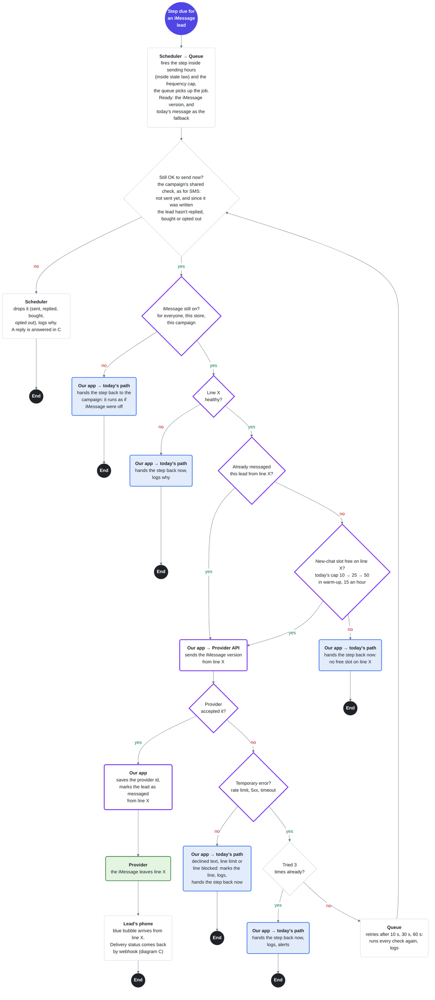

# iMessage: two flow diagrams

Back to the plan: [README.md](README.md)

**Why B and C:** messages leave a number and replies come back only in these two, so most failures happen here. A is manual in v1, and D is covered by the plan's section 3.

**Where this sits in today's flow:** lead joins a campaign → before each text step, the **iMessage check** → AI writes today's message as usual, plus an iMessage version if the lead can get it → scheduler: step is due → **B**, only for leads who passed: send-time checks, then iMessage from line X, or the step goes back to the campaign → **C:** statuses and replies → AI answers. Leads who can't get iMessage keep today's path.

**How to read:**
- 🟣 start (what triggers it) · ⚫ end, one per branch · ◇ a question, with yes and no arrows · ▢ an action, **bold** = who does it · 🟩 an iMessage leaves line X · 🟦 today's path: the step runs as if iMessage were off, the campaign's way, never from line X · 🟪 purple border: new for iMessage; grey border: as today, shared with SMS
- **Today's path** (🟦 blue boxes): what Outcraft does today, without iMessage. The step goes back to the campaign and runs as if iMessage were off, with the campaign's own channel, settings, frequency caps and checks. Often that's SMS from the store's own number, sometimes a call. The campaign decides, not B. The message is already written, so it goes at once, with no AI call.
  - **Our app → today's path:** iMessage was possible, but a send-time check or the provider said no. Our app hands the step back at once and logs why.
  - **AI → today's path** (diagram C): iMessage is off, line X fails mid-chat, or the answer still fails after retries. C has no answer written ahead, so the AI rewrites it for the campaign's other text channel.
- **Who does it:** our app, the scheduler, the queue, the AI, the provider, or the lead's phone.
- **Line X** is the store's iMessage line: one per store in v1, like its one SMS number. Every iMessage to the store's leads comes from it.
- **iMessage switches:** one for everyone on Outcraft (our team, or the circuit breaker when the provider is down), one per store (our admins), one per campaign. All three must be on.
- **Which steps:** iMessage is a fifth channel. A text step is an SMS step or an iMessage step. A campaign can add iMessage steps, each with a fallback the campaign sets (SMS or a call). For a lead on iMessage, SMS steps also go from line X. One number per lead: after a hand-back, the lead's next steps run as today.
- **Today's message:** what the campaign sends without iMessage. For an SMS step, the AI writes it as today. For an iMessage step, it's the message for its fallback (nothing to write for a call). The AI also writes an iMessage version.
- **What B leaves to today's system:** sending hours, state legal hours and the frequency cap (the scheduler fires the step inside them); reply, purchase and opt-out (the campaign's shared check, the same one SMS uses, run again at send time). B adds only the iMessage on-switch and line X's limits.
- **Legal hours in C:** live replies skip the scheduler, so C checks legal hours itself, with the same rule. It checks before the AI writes, so no answer waits for hours and goes out stale.
- **Checks in two places:** the full iMessage check runs before writing. At send time, the campaign's shared check and the on-switch run again, so nothing stale goes out. If the check, or the lookup, fails, the lead stays on today's path.
- **When iMessage fails:** if we know it didn't arrive (refused, failed, not on iMessage), today's message goes at once, the campaign's way. If we don't know (no delivery status in 15 min), we don't resend, so the lead never gets both. The lead is marked, and the next steps run as today.
- **The call after a text:** their default sequence calls about 3 minutes after a text step. That stays. If the lead replies first, the reply cancels scheduled steps, including that call (diagram C).
- **Logging:** every refusal, retry, fallback and drop is logged with its reason and the provider's error key.

---

## B. Sending a message: a step is due for an iMessage lead, up to the message leaving a number (or not)

**Before B, when the AI writes the step** (not drawn, it's one check):
1. **iMessage check:** iMessage on for the store and the campaign, a US/CA number, texting consent, not opted out, passes Do Not Call, not in FL, MD or OK during the pilot, the lookup says iMessage (cached 30 days), the iMessage group of the pilot, not handed back to today's path earlier in this campaign, and fewer than 2 unanswered iMessages. Any error, timeout or unknown means no.
2. **The AI writes today's message** as usual (for an iMessage step: the message for its fallback, none for a call). If the check passed, it also writes an **iMessage version**: a short question with no link until the lead has written to our line, then the full message.
3. **Both pass our content check,** or the AI rewrites them once. Still failing: nothing is sent, and the team is alerted.

**Leads who fail the check** (Android, no consent, outside the pilot group) get only today's message. The step runs as today and never enters B.

🟣 start (what triggers it) · ⚫ end, one per branch · ◇ a question, with yes and no arrows · ▢ an action, **bold** = who does it · 🟩 an iMessage leaves line X · 🟦 today's path: the step runs as if iMessage were off, the campaign's way, never from line X · 🟪 purple border: new for iMessage; grey border: as today, shared with SMS

If the diagram doesn't render: [diagram-b.png](diagram-b.png)

---

## C. Provider webhooks: statuses and a lead's reply, up to the AI's answer going out

Every event first passes the same checks. Then **C1** handles delivery statuses, and **C2** handles a lead's reply. C2 runs the same shared check as B before any answer goes out.

```mermaid
%%{init: {"theme": "base", "themeVariables": {"fontFamily": "Helvetica, Arial, sans-serif", "primaryColor": "#ffffff", "primaryBorderColor": "#d0d4db", "primaryTextColor": "#1f2328", "lineColor": "#6b7280", "edgeLabelBackground": "#ffffff"}, "themeCSS": "foreignObject { overflow: visible; } .nodeLabel { white-space: nowrap; } .cluster-label .nodeLabel { font-size: 20px; font-weight: 600; color: #374151; }", "flowchart": {"curve": "basis", "nodeSpacing": 40, "rankSpacing": 45, "padding": 18}}}%%
flowchart TD
    subgraph IN ["Every event, checked once"]
        S(("<b>Lead's phone<br/>writes, or a<br/>status arrives</b>")) --> P1("<b>Provider</b><br/>receives it on line X,<br/>sends a webhook to our app"):::new
        S2(("<b>Every 5 min:<br/>catch-up job</b>")) --> CU("<b>Our app</b><br/>pulls missed events, and finds messages<br/>with no delivery status after 15 min"):::new --> QR{"Message with no<br/>delivery status<br/>after 15 min?"}:::new
        QR -- yes --> DR("<b>Queue</b><br/>no resend: it may still arrive.<br/>Marks the lead not on iMessage,<br/>so the next steps run as today"):::new --> E13(("<b>End</b>"))
        QR -- no --> Q2
        P1 --> Q1{"Signature<br/>valid?"}
        Q1 -- yes --> Q2{"Seen this<br/>event id before?"}
        Q1 -- no --> X1("<b>Our app</b><br/>rejects it, logs") --> E1(("<b>End</b>"))
        Q2 -- yes --> X2("<b>Our app</b><br/>answers OK, ignores it") --> E2(("<b>End</b>"))
        Q2 -- no --> A1("<b>Our app</b><br/>saves the event, answers OK fast,<br/>puts it on the queue")
        A1 --> Q3{"Is it a reply<br/>from a lead?"}
    end

    subgraph C2 ["C2. A lead's reply, up to the AI's answer"]
        Q7{"Number matches<br/>a lead of this<br/>line's store?"}:::new
        Q7 -- no --> R1("<b>Our app</b><br/>saves to the inbox,<br/>tells the store") --> E7(("<b>End</b>"))
        Q7 -- yes --> Q8{"Asks to stop?<br/>STOP, unsubscribe,<br/>'stop texting me'..."}:::new
        Q8 -- yes --> R2("<b>Our app</b><br/>opts the lead out on all<br/>of this store's channels,<br/>cancels steps") --> OUT2("<b>Provider</b><br/>one confirmation leaves line X"):::out
        OUT2 --> E8(("<b>End</b>"))
        Q8 -- no --> R3("<b>Our app</b><br/>cancels scheduled steps,<br/>marks the lead as replied,<br/>no-link rule lifts")
        R3 --> Q9{"A person is handling<br/>this lead, or 30 AI<br/>replies reached?"}
        Q9 -- yes --> R4("<b>Our app</b><br/>notifies the person,<br/>AI stays quiet") --> E9(("<b>End</b>"))
        Q9 -- no --> QL{"Inside the lead's<br/>state legal hours?<br/>same rule as the scheduler"}
        QL -- no --> R9("<b>Queue</b><br/>waits until the hours open.<br/>The AI writes then,<br/>with the whole chat"):::new --> TY
        QL -- yes --> TY("<b>Provider</b><br/>shows typing dots<br/>on the lead's phone"):::new --> R5("<b>Queue</b><br/>waits 15 seconds"):::new --> Q10{"More messages<br/>came in meanwhile?"}:::new
        Q10 -- yes --> R5
        Q10 -- no --> AI("<b>AI</b><br/>reads the whole chat and the<br/>order status, writes one answer,<br/>picks the next step")
        AI --> Q11{"AI asks for<br/>a person?"}
        Q11 -- yes --> R4
        Q11 -- no --> QC{"Answer passes our<br/>content check?"}
        QC -- no --> R4
        QC -- yes --> QS{"Still OK to send now?<br/>the campaign's shared check, as for SMS:<br/>not sent yet, and since it was written<br/>the lead hasn't replied, bought or opted out"}
        QS -- no --> XS("<b>Our app</b><br/>drops the answer, logs why.<br/>A newer message gets<br/>its own answer") --> ES(("<b>End</b>"))
        QS -- yes --> Q12{"iMessage still on,<br/>and line X healthy?"}:::new
        Q12 -- no --> R6("<b>AI → today's path</b><br/>rewrites the answer for the<br/>campaign's other text channel,<br/>says it's the same store"):::sms --> E10(("<b>End</b>"))
        Q12 -- yes --> R7("<b>Queue</b><br/>priority send job on line X,<br/>campaign hours skipped:<br/>lead is active"):::new
        R7 --> Q13{"Provider accepted it?<br/>temporary errors retried<br/>after 10 s, 30 s, 60 s,<br/>like diagram B"}:::new
        Q13 -- no --> R6
        Q13 -- yes --> OUT("<b>Provider</b><br/>the answer leaves line X,<br/>the number the lead wrote to"):::out
        OUT --> PH("<b>Lead's phone</b><br/>answer arrives in<br/>the same thread") --> E11(("<b>End</b>"))
    end

    subgraph C1 ["C1. Delivery statuses"]
        Q4a{"Provider says<br/>line X is blocked?"}:::new
        Q4a -- yes --> D4
        Q4a -- no --> Q4{"Status: sent,<br/>delivered or read?"}
        Q4 -- yes --> D1("<b>Queue</b><br/>saves the status,<br/>updates line stats") --> E3(("<b>End</b>"))
        Q4 -- no --> Q5{"Provider says: not<br/>on iMessage?"}:::new
        Q5 -- yes --> D2("<b>Our app → today's path</b><br/>hands the step back now.<br/>Marks the lead not on iMessage"):::sms --> E4(("<b>End</b>"))
        Q5 -- no --> D3("<b>Queue</b><br/>the message failed: marks it,<br/>counts against the line, logs"):::new --> Q6{"Line now<br/>in red?"}:::new
        Q6 -- yes --> D4("<b>Our app</b><br/>stops new leads on the line,<br/>moves its chats to today's path,<br/>alerts Slack and the store"):::new --> E5(("<b>End</b>"))
        Q6 -- no --> D5("<b>Our app → today's path</b><br/>hands the step back now"):::sms --> E6(("<b>End</b>"))
    end

    Q3 -- yes --> Q7
    Q3 -- no --> Q4a

    style IN fill:#f8fafc,stroke:#e5e7eb,color:#4b5563
    style C1 fill:#f8fafc,stroke:#e5e7eb,color:#4b5563
    style C2 fill:#f8fafc,stroke:#e5e7eb,color:#4b5563

    classDef start fill:#4f46e5,stroke:#4f46e5,color:#ffffff
    classDef finish fill:#1f2328,stroke:#1f2328,color:#ffffff
    classDef action fill:#ffffff,stroke:#d0d4db,color:#1f2328
    classDef decision fill:#ffffff,stroke:#c4c8d0,color:#1f2328
    classDef out fill:#e3f5e1,stroke:#2e7d32,stroke-width:2px,color:#1f2328
    classDef sms fill:#e2ecfb,stroke:#2563eb,stroke-width:2px,color:#1f2328
    classDef new fill:#ffffff,stroke:#7c3aed,stroke-width:3px,color:#1f2328
    class S,S2 start
    class E13,E1,E2,E7,E8,E9,ES,E10,E11,E3,E4,E5,E6 finish
    class Q1,Q2,Q3,Q9,QL,Q11,QC,QS,Q4 decision
    class X1,X2,A1,R1,R2,R3,R4,AI,XS,PH,D1 action
    linkStyle 3,7,10,16,17,22,27,30,33,36,39,42,45,48,50,53,57,61 color:#15803d,stroke:#6b7280
    linkStyle 5,8,12,14,20,24,25,31,34,35,37,40,44,49,52,55,59,62 color:#b91c1c,stroke:#6b7280
```

🟣 start (what triggers it) · ⚫ end, one per branch · ◇ a question, with yes and no arrows · ▢ an action, **bold** = who does it · 🟩 an iMessage leaves line X · 🟦 today's path: the step runs as if iMessage were off, the campaign's way, never from line X · 🟪 purple border: new for iMessage; grey border: as today, shared with SMS

If the diagram doesn't render: [diagram-c.png](diagram-c.png)
