# iMessage: two flow diagrams

Back to the plan: [README.md](README.md)

**Why B and C:** messages leave a number and replies come back only in these two, so most failures happen here. A is manual in v1, and D is covered by the plan's section 3.

**How to read:**
- 🟣 start (what triggers it) · ⚫ end, one per branch · ◇ a question, with yes and no arrows · ▢ an action, **bold** = who does it · 🟩 an iMessage leaves line X · 🟦 the step moves to the next channel
- **Who does it:** our app, the queue, the AI, the provider, or the lead's phone.
- **Line X** is the store's iMessage line this lead is pinned to. Every iMessage to the lead comes from it.
- **Which steps:** iMessage is a fifth channel. When it's on, a lead on iMessage gets every text step, iMessage or SMS, from line X. One number per lead.
- **Next channel** (blue boxes): SMS from the store's SMS number if the campaign has SMS on, else the campaign's next channel, such as email or a call. That channel's own flow and checks take over.
- **Logging:** every refusal, retry, fallback and drop is logged with its reason and the provider's error key.

---

## B. Sending a message: a step is due, up to the message leaving a number (or not)

```mermaid
%%{init: {"theme": "base", "themeVariables": {"fontFamily": "Helvetica, Arial, sans-serif", "primaryColor": "#ffffff", "primaryBorderColor": "#d0d4db", "primaryTextColor": "#1f2328", "lineColor": "#6b7280", "edgeLabelBackground": "#ffffff"}, "themeCSS": "foreignObject { overflow: visible; } .nodeLabel { white-space: nowrap; }", "flowchart": {"curve": "basis", "nodeSpacing": 40, "rankSpacing": 45, "padding": 18}}}%%
flowchart TD
    S(("<b>Text step<br/>is due</b>")) --> A1("<b>Scheduler → Queue</b><br/>picks up the step job,<br/>iMessage or SMS")
    A1 --> Q0{"Already sent?<br/>same message id"}
    Q0 -- yes --> E0(("<b>End</b>"))
    Q0 -- no --> Q1{"iMessage on globally,<br/>for the store and the campaign,<br/>with a live line?"}
    Q1 -- no --> F1("<b>Our app</b><br/>hands the step to the campaign's<br/>next channel, no iMessage sent") --> E1(("<b>End</b>"))
    Q1 -- yes --> Q2{"US/CA number, consent,<br/>passes Do Not Call, not opted out,<br/>not texting us from another number?<br/>pilot: not FL, MD or OK"}
    Q2 -- no --> F2("<b>Our app</b><br/>next channel, no iMessage sent,<br/>logs why") --> E2(("<b>End</b>"))
    Q2 -- yes --> Q3{"iMessage result cached<br/>in the last 30 days?"}
    Q3 -- no --> L1("<b>Provider</b><br/>lookup: is this number on iMessage?") --> L2("<b>Our app</b><br/>saves the result") --> Q4
    Q3 -- yes --> Q4{"Lead is on<br/>iMessage?"}
    Q4 -- no --> F3("<b>Our app</b><br/>sends this step on<br/>the next channel"):::sms --> E3(("<b>End</b>"))
    Q4 -- yes --> QG{"Pilot: in the iMessage group?<br/>picked at random once<br/>per lead, then saved"}
    QG -- no --> F11("<b>Our app</b><br/>group without iMessage: the step<br/>runs as if iMessage were off,<br/>counted in the test"):::sms --> E15(("<b>End</b>"))
    QG -- yes --> QL{"Inside the lead's<br/>state legal hours?"}
    QL -- no --> R1("<b>Queue</b><br/>moves the step to the next window") --> E4(("<b>End</b>"))
    QL -- yes --> Q5{"Inside campaign hours, or lead<br/>wrote in the last 30 min?"}
    Q5 -- no --> R1
    Q5 -- yes --> Q6{"Lead already has<br/>an iMessage line?"}
    Q6 -- yes --> Q7{"Is that line<br/>healthy?"}
    Q7 -- no --> F4("<b>Our app</b><br/>sends on the next channel,<br/>logs why"):::sms --> E5(("<b>End</b>"))
    Q7 -- yes --> X1("<b>Our app</b><br/>keeps the same line = line X") --> Q10
    Q6 -- no --> Q8{"Any of the store's lines with a<br/>free new-contact slot? daily cap<br/>10 → 25 → 50 in warm-up,<br/>15 an hour"}
    Q8 -- yes --> X2("<b>Our app</b><br/>picks the line with most free slots<br/>= line X") --> Q10
    Q8 -- no --> Q9{"Lead waited over<br/>60 minutes?"}
    Q9 -- yes --> F5("<b>Our app</b><br/>sends this step on the next<br/>channel while the cart is fresh"):::sms --> E6(("<b>End</b>"))
    Q9 -- no --> R2("<b>Queue</b><br/>tries again in 10 min") --> E7(("<b>End</b>"))

    Q10{"Has the lead ever<br/>written to line X?"}
    Q10 -- yes --> AI2("<b>AI</b><br/>writes the full message,<br/>checkout link allowed") --> QC
    Q10 -- no --> Q11{"Already 2 iMessages<br/>with no reply?"}
    Q11 -- yes --> F6("<b>Our app</b><br/>moves the lead to the next<br/>channel, sends with the link"):::sms --> E8(("<b>End</b>"))
    Q11 -- no --> AI1("<b>AI</b><br/>writes a short question: names<br/>the brand, says it's an assistant,<br/>no link, max 300 characters") --> QC

    QC{"Passes our<br/>content check?"}
    QC -- no --> QC2{"Already<br/>rewritten once?"}
    QC2 -- no --> AI4("<b>AI</b><br/>rewrites the message") --> QC
    QC2 -- yes --> F10("<b>Our app</b><br/>does not send, logs,<br/>alerts the team") --> E13(("<b>End</b>"))
    QC -- yes --> Q12

    Q12{"Free sending slot<br/>on line X right now?"}
    Q12 -- no --> R3("<b>Queue</b><br/>waits a few seconds") --> Q12
    Q12 -- yes --> QS{"Step still wanted?<br/>no reply, purchase or<br/>opt-out since it was due"}
    QS -- no --> X3("<b>Queue</b><br/>drops the step, logs why") --> E14(("<b>End</b>"))
    QS -- yes --> SEND("<b>Our app → Provider API</b><br/>send from line X")
    SEND --> Q13{"Provider<br/>accepted it?"}
    Q13 -- yes --> OK2("<b>Our app</b><br/>saves provider id,<br/>pins the lead to line X")
    OK2 --> OUT("<b>Provider</b><br/>the message leaves line X"):::out
    OUT --> PH("<b>Lead's phone</b><br/>blue bubble arrives from line X.<br/>Delivery status comes back<br/>by webhook (diagram C)")
    PH --> E9(("<b>End</b>"))
    Q13 -- no --> Q14{"Temporary error?<br/>rate limit, 5xx, timeout"}
    Q14 -- yes --> Q15{"Tried 3<br/>times already?"}
    Q15 -- no --> R4("<b>Queue</b><br/>retries with a growing delay, logs") --> Q12
    Q15 -- yes --> F7("<b>Our app</b><br/>sends on the next channel,<br/>logs, alerts"):::sms --> E10(("<b>End</b>"))
    Q14 -- no --> Q16{"Declined because<br/>of the text?"}
    Q16 -- yes --> Q17{"Already<br/>rewritten once?"}
    Q17 -- no --> AI3("<b>AI</b><br/>rewrites without the blocked part") --> Q12
    Q17 -- yes --> F8("<b>Our app</b><br/>sends on the next channel,<br/>logs why"):::sms --> E11(("<b>End</b>"))
    Q16 -- no --> F9("<b>Our app</b><br/>line limit hit or line blocked:<br/>marks the line, logs,<br/>health check runs,<br/>sends this step on<br/>the next channel"):::sms --> E12(("<b>End</b>"))

    classDef start fill:#4f46e5,stroke:#4f46e5,color:#ffffff
    classDef finish fill:#1f2328,stroke:#1f2328,color:#ffffff
    classDef action fill:#ffffff,stroke:#d0d4db,color:#1f2328
    classDef decision fill:#ffffff,stroke:#c4c8d0,color:#1f2328
    classDef out fill:#e3f5e1,stroke:#2e7d32,stroke-width:2px,color:#1f2328
    classDef sms fill:#e2ecfb,stroke:#2563eb,stroke-width:2px,color:#1f2328
    class S start
    class E0,E1,E2,E3,E15,E4,E5,E6,E7,E8,E13,E14,E9,E10,E11,E12 finish
    class Q0,Q1,Q2,Q3,Q4,QG,QL,Q5,Q6,Q7,Q8,Q9,Q10,Q11,QC,QC2,Q12,QS,Q13,Q14,Q15,Q16,Q17 decision
    class A1,F1,F2,L1,L2,R1,X1,X2,R2,AI2,AI1,AI4,F10,R3,X3,SEND,OK2,PH,R4,AI3 action
    linkStyle 2,6,9,13,16,19,22,24,25,28,31,34,38,41,48,50,53,56,58,63,66,69,72 color:#15803d,stroke:#6b7280
    linkStyle 3,4,7,10,14,17,20,23,26,30,33,36,40,43,45,46,51,54,62,64,68,70,74 color:#b91c1c,stroke:#6b7280
```

🟣 start (what triggers it) · ⚫ end, one per branch · ◇ a question, with yes and no arrows · ▢ an action, **bold** = who does it · 🟩 an iMessage leaves line X · 🟦 the step moves to the next channel

If the diagram doesn't render: [diagram-b.png](diagram-b.png)

---

## C. Provider webhooks: statuses and a lead's reply, up to the AI's answer going out

```mermaid
%%{init: {"theme": "base", "themeVariables": {"fontFamily": "Helvetica, Arial, sans-serif", "primaryColor": "#ffffff", "primaryBorderColor": "#d0d4db", "primaryTextColor": "#1f2328", "lineColor": "#6b7280", "edgeLabelBackground": "#ffffff"}, "themeCSS": "foreignObject { overflow: visible; } .nodeLabel { white-space: nowrap; }", "flowchart": {"curve": "basis", "nodeSpacing": 40, "rankSpacing": 45, "padding": 18}}}%%
flowchart TD
    S(("<b>Lead's phone<br/>writes, or a<br/>receipt arrives</b>")) --> P1("<b>Provider</b><br/>receives it on line X,<br/>sends a webhook to our app")
    S2(("<b>Every 5 min:<br/>catch-up job</b>")) --> CU("<b>Our app</b><br/>pulls missed events and messages<br/>with no receipt after 1 hour") --> Q2
    P1 --> Q1{"Signature<br/>valid?"}
    Q1 -- no --> X1("<b>Our app</b><br/>rejects it, logs") --> E1(("<b>End</b>"))
    Q1 -- yes --> Q2{"Seen this<br/>event id before?"}
    Q2 -- yes --> X2("<b>Our app</b><br/>answers OK, ignores it") --> E2(("<b>End</b>"))
    Q2 -- no --> A1("<b>Our app</b><br/>saves the event, answers OK fast,<br/>puts it on the queue")
    A1 --> Q3{"Is it a reply<br/>from a lead?"}

    Q3 -- no --> Q4a{"Provider says<br/>line X is blocked?"}
    Q4a -- yes --> D4
    Q4a -- no --> Q4{"Status:<br/>delivered?"}
    Q4 -- yes --> D1("<b>Queue</b><br/>marks message delivered,<br/>updates line stats") --> E3(("<b>End</b>"))
    Q4 -- no --> Q5{"Went as SMS, not on<br/>iMessage, or no receipt<br/>after 1 hour?"}
    Q5 -- yes --> D2("<b>Queue</b><br/>marks lead not on iMessage,<br/>clears the lookup cache,<br/>next steps go on<br/>the next channel") --> E4(("<b>End</b>"))
    Q5 -- no --> D3("<b>Queue</b><br/>marks message failed,<br/>counts against the line, logs") --> Q6{"Line now<br/>in red?"}
    Q6 -- yes --> D4("<b>Our app</b><br/>stops new leads on the line,<br/>moves its chats to the next channel,<br/>alerts Slack and the store") --> E5(("<b>End</b>"))
    Q6 -- no --> D5("<b>Queue</b><br/>sends the step on<br/>the next channel"):::sms --> E6(("<b>End</b>"))

    Q3 -- yes --> Q7{"Number matches<br/>a lead of this<br/>line's store?"}
    Q7 -- no --> R1("<b>Our app</b><br/>saves to the inbox,<br/>tells the store") --> E7(("<b>End</b>"))
    Q7 -- yes --> Q8{"Asks to stop?<br/>STOP, unsubscribe,<br/>'stop texting me'..."}
    Q8 -- yes --> R2("<b>Our app</b><br/>opts the lead out on all<br/>of this store's channels,<br/>cancels steps") --> OUT2("<b>Provider</b><br/>one confirmation leaves line X"):::out
    OUT2 --> E8(("<b>End</b>"))
    Q8 -- no --> R3("<b>Our app</b><br/>pins the lead to line X,<br/>cancels scheduled steps,<br/>marks lead 'in chat',<br/>no-link rule lifts")
    R3 --> Q9{"A person is handling<br/>this lead, or 30 AI<br/>replies reached?"}
    Q9 -- yes --> R4("<b>Our app</b><br/>notifies the person,<br/>AI stays quiet") --> E9(("<b>End</b>"))
    Q9 -- no --> TY("<b>Provider</b><br/>shows typing dots<br/>on the lead's phone") --> R5("<b>Queue</b><br/>waits 15 seconds") --> Q10{"More messages<br/>came in meanwhile?"}
    Q10 -- yes --> R5
    Q10 -- no --> AI("<b>AI</b><br/>reads the whole chat, writes<br/>one answer, picks the next step")
    AI --> Q11{"AI asks for<br/>a person?"}
    Q11 -- yes --> R4
    Q11 -- no --> QC{"Answer passes our<br/>content check?"}
    QC -- no --> R4
    QC -- yes --> Q12{"Line X still<br/>healthy?"}
    Q12 -- no --> R6("<b>Our app</b><br/>sends the answer on<br/>the next channel"):::sms --> E10(("<b>End</b>"))
    Q12 -- yes --> QL{"Inside the lead's<br/>state legal hours?"}
    QL -- no --> R9("<b>Queue</b><br/>holds the answer<br/>until the hours open") --> R7
    QL -- yes --> R7("<b>Queue</b><br/>priority send job on line X,<br/>campaign hours skipped:<br/>lead is active")
    R7 --> Q13{"Provider<br/>accepted it?"}
    Q13 -- yes --> OUT("<b>Provider</b><br/>the answer leaves line X,<br/>the number the lead wrote to"):::out
    OUT --> PH("<b>Lead's phone</b><br/>answer arrives in<br/>the same thread") --> E11(("<b>End</b>"))
    Q13 -- no --> R8("<b>Queue</b><br/>same retry and fallback rules<br/>as diagram B") --> E12(("<b>End</b>"))

    classDef start fill:#4f46e5,stroke:#4f46e5,color:#ffffff
    classDef finish fill:#1f2328,stroke:#1f2328,color:#ffffff
    classDef action fill:#ffffff,stroke:#d0d4db,color:#1f2328
    classDef decision fill:#ffffff,stroke:#c4c8d0,color:#1f2328
    classDef out fill:#e3f5e1,stroke:#2e7d32,stroke-width:2px,color:#1f2328
    classDef sms fill:#e2ecfb,stroke:#2563eb,stroke-width:2px,color:#1f2328
    class S,S2 start
    class E1,E2,E3,E4,E5,E6,E7,E8,E9,E10,E11,E12 finish
    class Q1,Q2,Q3,Q4a,Q4,Q5,Q6,Q7,Q8,Q9,Q10,Q11,QC,Q12,QL,Q13 decision
    class P1,CU,X1,X2,A1,D1,D2,D3,D4,R1,R2,R3,R4,TY,R5,AI,R9,R7,PH,R8 action
    linkStyle 6,7,12,14,17,21,25,28,29,34,39,42,45,48,51,53 color:#15803d,stroke:#6b7280
    linkStyle 4,9,11,13,16,19,23,26,32,36,40,43,44,46,49,56 color:#b91c1c,stroke:#6b7280
```

🟣 start (what triggers it) · ⚫ end, one per branch · ◇ a question, with yes and no arrows · ▢ an action, **bold** = who does it · 🟩 an iMessage leaves line X · 🟦 the step moves to the next channel

If the diagram doesn't render: [diagram-c.png](diagram-c.png)
