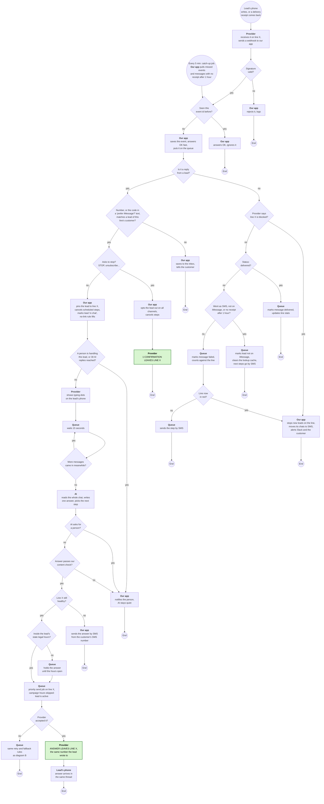

# iMessage: two flow diagrams

Back to the plan: [README.md](README.md)

**Why B and C:** these are where a message actually leaves a number and where replies come back. Most failures happen here, and so does the live-chat behaviour. A (setting up lines) is done by our admins by hand in v1. D (line health) is covered by the automatic rules in the plan, section 3. In phase 1 only C runs: leads who tap "prefer iMessage?" write first and enter at its top. B starts in phase 2.

**How to read:** a circle is the start or an end. A diamond is a question with yes and no arrows. A box is an action, and the bold text says **who** does it: our app, the queue, the AI, the provider, or the lead's phone. Green boxes mark the moment a message actually leaves a number, and which number. A box that sends "by SMS" hands the step to our existing SMS flow, which sends it from the customer's SMS number.

---

## B. Sending a message: a step is due, up to the message leaving a number (or not)

```mermaid
flowchart TD
    S(("Campaign step<br/>is due")) --> A1["<b>Scheduler → Queue</b><br/>picks up the step job"]
    A1 --> Q0{"Already sent?<br/>same message id"}
    Q0 -- yes --> E0((End))
    Q0 -- no --> Q1{"Outbound iMessage switched on<br/>globally, for the customer and<br/>the campaign, and a live line?<br/>off in phase 1"}
    Q1 -- no --> F1["<b>Our app</b><br/>uses the campaign's next channel"] --> E1((End))
    Q1 -- yes --> Q2{"US/CA number, has consent,<br/>not opted out, not texting<br/>with us from another number?<br/>pilot: not FL, MD or OK"}
    Q2 -- no --> F2["<b>Our app</b><br/>uses next channel, logs why"] --> E2((End))
    Q2 -- yes --> Q3{"iMessage result cached<br/>in last 30 days?"}
    Q3 -- no --> L1["<b>Provider</b><br/>lookup: is this number on iMessage?"] --> L2["<b>Our app</b><br/>saves the result"] --> Q4
    Q3 -- yes --> Q4{"Lead is on<br/>iMessage?"}
    Q4 -- no --> F3["<b>Our app</b><br/>sends this step by SMS<br/>from the customer's SMS number"] --> E3((End))
    Q4 -- yes --> QL{"Inside the lead's<br/>state legal hours?"}
    QL -- no --> R1["<b>Queue</b><br/>moves the step to the next window"] --> E4((End))
    QL -- yes --> Q5{"Inside campaign hours, or lead<br/>wrote in the last 30 min?"}
    Q5 -- no --> R1
    Q5 -- yes --> Q6{"Lead already has<br/>an iMessage line?"}
    Q6 -- yes --> Q7{"Is that line<br/>healthy?"}
    Q7 -- no --> F4["<b>Our app</b><br/>sends by SMS, logs why"] --> E5((End))
    Q7 -- yes --> X1["<b>Our app</b><br/>keeps the same line = line X"] --> Q10
    Q6 -- no --> Q8{"Any customer line with a free<br/>new-contact slot? daily cap<br/>10 → 25 → 50 in warm-up,<br/>15 an hour"}
    Q8 -- yes --> X2["<b>Our app</b><br/>picks the line with most free slots<br/>= line X"] --> Q10
    Q8 -- no --> Q9{"Lead waited over<br/>60 minutes?"}
    Q9 -- yes --> F5["<b>Our app</b><br/>sends this step by SMS<br/>while the cart is fresh"] --> E6((End))
    Q9 -- no --> R2["<b>Queue</b><br/>tries again in 10 min"] --> E7((End))

    Q10{"Has the lead ever<br/>written to line X?"}
    Q10 -- yes --> AI2["<b>AI</b><br/>writes the full message,<br/>checkout link allowed"] --> QC
    Q10 -- no --> Q11{"Already 2 iMessages<br/>with no reply?"}
    Q11 -- yes --> F6["<b>Our app</b><br/>moves the lead to SMS,<br/>sends with the link"] --> E8((End))
    Q11 -- no --> AI1["<b>AI</b><br/>writes a short question: names<br/>the brand, says it's an assistant,<br/>no link, max 300 characters"] --> QC

    QC{"Passes our<br/>content check?"}
    QC -- no --> QC2{"Already<br/>rewritten once?"}
    QC2 -- no --> AI4["<b>AI</b><br/>rewrites the message"] --> QC
    QC2 -- yes --> F10["<b>Our app</b><br/>does not send, logs,<br/>alerts the team"] --> E13((End))
    QC -- yes --> Q12

    Q12{"Free sending slot<br/>on line X right now?"}
    Q12 -- no --> R3["<b>Queue</b><br/>waits a few seconds"] --> Q12
    Q12 -- yes --> QS{"Step still wanted?<br/>no reply or purchase<br/>since it was due"}
    QS -- no --> X3["<b>Queue</b><br/>drops the step, logs why"] --> E14((End))
    QS -- yes --> SEND["<b>Our app → Provider API</b><br/>send from line X"]
    SEND --> Q13{"Provider<br/>accepted it?"}
    Q13 -- yes --> OK2["<b>Our app</b><br/>saves provider id,<br/>pins the lead to line X"]
    OK2 --> OUT["<b>Provider</b><br/>MESSAGE LEAVES LINE X"]:::out
    OUT --> PH["<b>Lead's phone</b><br/>blue bubble arrives<br/>from line X"]
    PH --> E9(("End<br/>delivery status<br/>comes by webhook, C"))
    Q13 -- no --> Q14{"Temporary error?<br/>rate limit, 5xx, timeout"}
    Q14 -- yes --> Q15{"Tried 3<br/>times already?"}
    Q15 -- no --> R4["<b>Queue</b><br/>retries with a growing delay"] --> Q12
    Q15 -- yes --> F7["<b>Our app</b><br/>sends by SMS, alerts"] --> E10((End))
    Q14 -- no --> Q16{"Declined because<br/>of the text?"}
    Q16 -- yes --> Q17{"Already<br/>rewritten once?"}
    Q17 -- no --> AI3["<b>AI</b><br/>rewrites without the blocked part"] --> Q12
    Q17 -- yes --> F8["<b>Our app</b><br/>sends by SMS, logs why"] --> E11((End))
    Q16 -- no --> F9["<b>Our app</b><br/>line limit hit or line blocked:<br/>marks line, health check runs,<br/>sends this step by SMS"] --> E12((End))

    classDef out fill:#d8f5d0,stroke:#2e7d32,stroke-width:2px,color:#000
```

If the diagram doesn't render: [diagram-b.png](diagram-b.png)

---

## C. Provider webhooks: statuses and a lead's reply, up to the AI's answer going out

If the diagram doesn't render: [diagram-c.png](diagram-c.png)
