# iMessage: two flow diagrams

Back to the plan: [README.md](README.md)

**Why B and C:** messages leave a number and replies come back only in these two, so most failures happen here. A is manual in v1, and D is covered by the plan's section 3.

**Where this sits in today's flow:** lead joins a campaign → before each text step, the **iMessage check** → AI writes today's message as usual, plus an iMessage version if the lead can get it → scheduler: step is due → **B:** send-time checks, then iMessage from line X, or the step goes back to the campaign → **C:** statuses and replies → AI answers. Leads who can't get iMessage keep today's path.

**How to read:**
- 🟣 start (what triggers it) · ⚫ end, one per branch · ◇ a question, with yes and no arrows · ▢ an action, **bold** = who does it · 🟩 an iMessage leaves line X · 🟦 the step goes back to the campaign: it leaves from the store's own number, as today
- **Who does it:** our app, the scheduler, the queue, the AI, the provider, or the lead's phone.
- **Line X** is the store's iMessage line this lead is pinned to. Every iMessage to the lead comes from it.
- **Which steps:** iMessage is a fifth channel. When it's on, a lead on iMessage gets every text step, iMessage or SMS, from line X. One number per lead.
- **Today's message** (blue boxes): the AI writes the step as it does today, plus an iMessage version. When iMessage can't be used, the step goes back to the campaign and runs as if iMessage were off, with the campaign's own channel, settings, frequency caps and checks. Often that's SMS from the store's number, but it can be a call. The campaign decides, not B.
- **One check, two places:** the iMessage check runs before writing and again at send time. If it, or the lookup, fails, the lead stays on today's path.
- **When iMessage fails:** if we know it didn't arrive (refused, failed, not on iMessage), today's message goes at once, the campaign's way. If we don't know (no receipt in 15 min), we don't resend, so the lead never gets both. The lead is marked, and the next steps run as today.
- **The call after a text:** their default sequence calls about 3 minutes after a text step. That stays. If the lead replies first, the reply cancels scheduled steps, including that call (diagram C).
- **Logging:** every refusal, retry, fallback and drop is logged with its reason and the provider's error key.

---

## B. Sending a message: from writing the step, up to the message leaving a number (or not)

```mermaid
%%{init: {"theme": "base", "themeVariables": {"fontFamily": "Helvetica, Arial, sans-serif", "primaryColor": "#ffffff", "primaryBorderColor": "#d0d4db", "primaryTextColor": "#1f2328", "lineColor": "#6b7280", "edgeLabelBackground": "#ffffff"}, "themeCSS": "foreignObject { overflow: visible; } .nodeLabel { white-space: nowrap; }", "flowchart": {"curve": "basis", "nodeSpacing": 40, "rankSpacing": 45, "padding": 18}}}%%
flowchart TD
    S(("<b>Next step is<br/>a text step</b>")) --> Q1{"iMessage check: on for the store<br/>and the campaign, US/CA number,<br/>texting consent, not opted out,<br/>passes Do Not Call?<br/>pilot: not FL, MD or OK"}
    Q1 -- no --> W1("<b>AI</b><br/>writes today's message only:<br/>today's path, unchanged")
    W1 --> SMS0("<b>Scheduler → today's path</b><br/>the campaign sends it when due,<br/>from the store's own number"):::sms --> E1(("<b>End</b>"))
    Q1 -- yes --> Q2{"iMessage result cached<br/>in the last 30 days?"}
    Q2 -- no --> L1("<b>Provider</b><br/>lookup: is this number<br/>on iMessage?") --> Q3{"Lookup<br/>answered?"}
    Q3 -- no --> W1
    Q3 -- yes --> L2("<b>Our app</b><br/>saves the result") --> Q4
    Q2 -- yes --> Q4{"Lead is on<br/>iMessage?"}
    Q4 -- no --> W1
    Q4 -- yes --> QG{"Pilot: in the iMessage group?<br/>picked at random once<br/>per lead, then saved"}
    QG -- no --> W1
    QG -- yes --> Q10{"Has the lead ever written<br/>to our iMessage line?"}
    Q10 -- yes --> AI2("<b>AI</b><br/>writes today's message<br/>and an iMessage version,<br/>link allowed") --> QC
    Q10 -- no --> Q11{"Already 2 iMessages<br/>with no reply?"}
    Q11 -- yes --> W1
    Q11 -- no --> AI1("<b>AI</b><br/>writes today's message and an<br/>iMessage version: a short question,<br/>names the brand, says it's<br/>an assistant, no link") --> QC

    QC{"Both pass our<br/>content check?"}
    QC -- no --> QC2{"Already<br/>rewritten once?"}
    QC2 -- no --> AI4("<b>AI</b><br/>rewrites them") --> QC
    QC2 -- yes --> F10("<b>Our app</b><br/>does not send, logs,<br/>alerts the team") --> E13(("<b>End</b>"))
    QC -- yes --> WT("<b>Scheduler → Queue</b><br/>the step is due,<br/>picks up the job")
    WT --> Q0{"Already sent?<br/>same message id"}
    Q0 -- yes --> E0(("<b>End</b>"))
    Q0 -- no --> QS{"Step still wanted?<br/>no reply, purchase or opt-out<br/>since it was written, and inside<br/>the campaign's frequency cap"}
    QS -- no --> X3("<b>Queue</b><br/>drops or holds the step,<br/>as today, logs why") --> E14(("<b>End</b>"))
    QS -- yes --> QI{"iMessage check<br/>still passes?"}
    QI -- no --> SMS1("<b>Our app → today's path</b><br/>hands the step back to the<br/>campaign: it runs as if<br/>iMessage were off"):::sms --> E2(("<b>End</b>"))
    QI -- yes --> QL{"Inside the lead's<br/>state legal hours?"}
    QL -- no --> R1("<b>Queue</b><br/>moves the step to the next window") --> E4(("<b>End</b>"))
    QL -- yes --> Q5{"Inside campaign hours, or lead<br/>wrote in the last 30 min?"}
    Q5 -- no --> R1
    Q5 -- yes --> Q6{"Lead already has<br/>an iMessage line?"}
    Q6 -- yes --> Q7{"Is that line<br/>healthy?"}
    Q7 -- no --> SMS2("<b>Our app → today's path</b><br/>hands the step back now,<br/>logs why"):::sms --> E5(("<b>End</b>"))
    Q7 -- yes --> X1("<b>Our app</b><br/>keeps the same line = line X") --> Q12
    Q6 -- no --> Q8{"Any of the store's lines with a<br/>free new-contact slot? daily cap<br/>10 → 25 → 50 in warm-up,<br/>15 an hour"}
    Q8 -- yes --> X2("<b>Our app</b><br/>picks the line with most free slots<br/>= line X") --> Q12
    Q8 -- no --> Q9{"Daily caps all used,<br/>or lead waited<br/>over 10 minutes?"}
    Q9 -- yes --> SMS3("<b>Our app → today's path</b><br/>hands the step back now,<br/>while the cart is fresh"):::sms --> E6(("<b>End</b>"))
    Q9 -- no --> R2("<b>Queue</b><br/>tries again in 2 min") --> E7(("<b>End</b>"))

    Q12{"Free sending slot<br/>on line X right now?"}
    Q12 -- no --> R3("<b>Queue</b><br/>waits a few seconds") --> Q12
    Q12 -- yes --> SEND("<b>Our app → Provider API</b><br/>sends the iMessage version<br/>from line X")
    SEND --> Q13{"Provider<br/>accepted it?"}
    Q13 -- yes --> OK2("<b>Our app</b><br/>saves provider id,<br/>pins the lead to line X")
    OK2 --> OUT("<b>Provider</b><br/>the iMessage leaves line X"):::out
    OUT --> PH("<b>Lead's phone</b><br/>blue bubble arrives from line X.<br/>Delivery status comes back<br/>by webhook (diagram C)")
    PH --> E9(("<b>End</b>"))
    Q13 -- no --> Q14{"Temporary error?<br/>rate limit, 5xx, timeout"}
    Q14 -- yes --> Q15{"Tried 3<br/>times already?"}
    Q15 -- no --> R4("<b>Queue</b><br/>retries after 10 s, 30 s, 60 s, logs") --> Q12
    Q15 -- yes --> SMS4("<b>Our app → today's path</b><br/>hands the step back now,<br/>logs, alerts"):::sms --> E10(("<b>End</b>"))
    Q14 -- no --> SMS5("<b>Our app → today's path</b><br/>declined text, line limit or<br/>line blocked: marks the line, logs,<br/>hands the step back now"):::sms --> E11(("<b>End</b>"))

    classDef start fill:#4f46e5,stroke:#4f46e5,color:#ffffff
    classDef finish fill:#1f2328,stroke:#1f2328,color:#ffffff
    classDef action fill:#ffffff,stroke:#d0d4db,color:#1f2328
    classDef decision fill:#ffffff,stroke:#c4c8d0,color:#1f2328
    classDef out fill:#e3f5e1,stroke:#2e7d32,stroke-width:2px,color:#1f2328
    classDef sms fill:#e2ecfb,stroke:#2563eb,stroke-width:2px,color:#1f2328
    class S start
    class E0,E1,E2,E4,E5,E6,E7,E9,E10,E11,E13,E14 finish
    class Q1,Q2,Q3,Q4,QG,Q10,Q11,QC,QC2,Q0,QS,QI,QL,Q5,Q6,Q7,Q8,Q9,Q12,Q13,Q14,Q15 decision
    class W1,L1,L2,AI2,AI1,AI4,F10,WT,X3,R1,X1,X2,R2,R3,SEND,OK2,PH,R4 action
    linkStyle 4,8,10,12,14,15,18,24,26,28,32,35,38,40,41,44,47,50,56,58,63,66 color:#15803d,stroke:#6b7280
    linkStyle 1,5,7,11,13,17,19,21,22,29,30,33,36,39,42,46,49,52,54,62,64,68 color:#b91c1c,stroke:#6b7280
```

🟣 start (what triggers it) · ⚫ end, one per branch · ◇ a question, with yes and no arrows · ▢ an action, **bold** = who does it · 🟩 an iMessage leaves line X · 🟦 the step goes back to the campaign: it leaves from the store's own number, as today

If the diagram doesn't render: [diagram-b.png](diagram-b.png)

---

## C. Provider webhooks: statuses and a lead's reply, up to the AI's answer going out

```mermaid
%%{init: {"theme": "base", "themeVariables": {"fontFamily": "Helvetica, Arial, sans-serif", "primaryColor": "#ffffff", "primaryBorderColor": "#d0d4db", "primaryTextColor": "#1f2328", "lineColor": "#6b7280", "edgeLabelBackground": "#ffffff"}, "themeCSS": "foreignObject { overflow: visible; } .nodeLabel { white-space: nowrap; }", "flowchart": {"curve": "basis", "nodeSpacing": 40, "rankSpacing": 45, "padding": 18}}}%%
flowchart TD
    S(("<b>Lead's phone<br/>writes, or a<br/>receipt arrives</b>")) --> P1("<b>Provider</b><br/>receives it on line X,<br/>sends a webhook to our app")
    S2(("<b>Every 5 min:<br/>catch-up job</b>")) --> CU("<b>Our app</b><br/>pulls missed events and messages<br/>with no receipt after 15 min") --> Q2
    P1 --> Q1{"Signature<br/>valid?"}
    Q1 -- no --> X1("<b>Our app</b><br/>rejects it, logs") --> E1(("<b>End</b>"))
    Q1 -- yes --> Q2{"Seen this<br/>event id before?"}
    Q2 -- yes --> X2("<b>Our app</b><br/>answers OK, ignores it") --> E2(("<b>End</b>"))
    Q2 -- no --> A1("<b>Our app</b><br/>saves the event, answers OK fast,<br/>puts it on the queue")
    A1 --> Q3{"Is it a reply<br/>from a lead?"}

    Q3 -- no --> Q4a{"Provider says<br/>line X is blocked?"}
    Q4a -- yes --> D4
    Q4a -- no --> Q4{"Status:<br/>delivered?"}
    Q4 -- yes --> D1("<b>Queue</b><br/>marks message delivered,<br/>updates line stats") --> E3(("<b>End</b>"))
    Q4 -- no --> Q5{"Provider says: not<br/>on iMessage?"}
    Q5 -- yes --> D2("<b>Our app → today's path</b><br/>hands the step back now.<br/>Marks the lead not on iMessage"):::sms --> E4(("<b>End</b>"))
    Q5 -- no --> QR{"No receipt<br/>after 15 min?"}
    QR -- yes --> DR("<b>Queue</b><br/>no resend: it may still arrive.<br/>Marks the lead not on iMessage,<br/>so the next steps run as today") --> E13(("<b>End</b>"))
    QR -- no --> D3("<b>Queue</b><br/>marks message failed,<br/>counts against the line, logs") --> Q6{"Line now<br/>in red?"}
    Q6 -- yes --> D4("<b>Our app</b><br/>stops new leads on the line,<br/>moves its chats to today's path,<br/>alerts Slack and the store") --> E5(("<b>End</b>"))
    Q6 -- no --> D5("<b>Our app → today's path</b><br/>hands the step back now"):::sms --> E6(("<b>End</b>"))

    Q3 -- yes --> Q7{"Number matches<br/>a lead of this<br/>line's store?"}
    Q7 -- no --> R1("<b>Our app</b><br/>saves to the inbox,<br/>tells the store") --> E7(("<b>End</b>"))
    Q7 -- yes --> Q8{"Asks to stop?<br/>STOP, unsubscribe,<br/>'stop texting me'..."}
    Q8 -- yes --> R2("<b>Our app</b><br/>opts the lead out on all<br/>of this store's channels,<br/>cancels steps") --> OUT2("<b>Provider</b><br/>one confirmation leaves line X"):::out
    OUT2 --> E8(("<b>End</b>"))
    Q8 -- no --> R3("<b>Our app</b><br/>pins the lead to line X,<br/>cancels scheduled steps,<br/>marks lead 'in chat',<br/>no-link rule lifts")
    R3 --> Q9{"A person is handling<br/>this lead, or 30 AI<br/>replies reached?"}
    Q9 -- yes --> R4("<b>Our app</b><br/>notifies the person,<br/>AI stays quiet") --> E9(("<b>End</b>"))
    Q9 -- no --> TY("<b>Provider</b><br/>shows typing dots<br/>on the lead's phone") --> R5("<b>Queue</b><br/>waits 15 seconds") --> Q10{"More messages<br/>came in meanwhile?"}
    Q10 -- yes --> R5
    Q10 -- no --> AI("<b>AI</b><br/>reads the whole chat, writes<br/>one answer, picks the next step")
    AI --> Q11{"AI asks for<br/>a person?"}
    Q11 -- yes --> R4
    Q11 -- no --> QC{"Answer passes our<br/>content check?"}
    QC -- no --> R4
    QC -- yes --> Q12{"Line X still<br/>healthy?"}
    Q12 -- no --> R6("<b>AI → today's path</b><br/>rewrites the answer for the<br/>campaign's other text channel,<br/>says it's the same store"):::sms --> E10(("<b>End</b>"))
    Q12 -- yes --> QL{"Inside the lead's<br/>state legal hours?"}
    QL -- no --> R9("<b>Queue</b><br/>holds the answer<br/>until the hours open") --> R7
    QL -- yes --> R7("<b>Queue</b><br/>priority send job on line X,<br/>campaign hours skipped:<br/>lead is active")
    R7 --> Q13{"Provider<br/>accepted it?"}
    Q13 -- yes --> OUT("<b>Provider</b><br/>the answer leaves line X,<br/>the number the lead wrote to"):::out
    OUT --> PH("<b>Lead's phone</b><br/>answer arrives in<br/>the same thread") --> E11(("<b>End</b>"))
    Q13 -- no --> R8("<b>Queue</b><br/>same retry and fallback rules<br/>as diagram B") --> E12(("<b>End</b>"))

    classDef start fill:#4f46e5,stroke:#4f46e5,color:#ffffff
    classDef finish fill:#1f2328,stroke:#1f2328,color:#ffffff
    classDef action fill:#ffffff,stroke:#d0d4db,color:#1f2328
    classDef decision fill:#ffffff,stroke:#c4c8d0,color:#1f2328
    classDef out fill:#e3f5e1,stroke:#2e7d32,stroke-width:2px,color:#1f2328
    classDef sms fill:#e2ecfb,stroke:#2563eb,stroke-width:2px,color:#1f2328
    class S,S2 start
    class E1,E2,E3,E4,E5,E6,E7,E8,E9,E10,E11,E12,E13 finish
    class Q1,Q2,Q3,Q4a,Q4,Q5,QR,Q6,Q7,Q8,Q9,Q10,Q11,QC,Q12,QL,Q13 decision
    class P1,CU,X1,X2,A1,D1,DR,D3,D4,R1,R2,R3,R4,TY,R5,AI,R9,R7,PH,R8 action
    linkStyle 6,7,12,14,17,20,24,28,31,32,37,42,45,48,51,54,56 color:#15803d,stroke:#6b7280
    linkStyle 4,9,11,13,16,19,22,26,29,35,39,43,46,47,49,52,59 color:#b91c1c,stroke:#6b7280
```

🟣 start (what triggers it) · ⚫ end, one per branch · ◇ a question, with yes and no arrows · ▢ an action, **bold** = who does it · 🟩 an iMessage leaves line X · 🟦 the step goes back to the campaign: it leaves from the store's own number, as today

If the diagram doesn't render: [diagram-c.png](diagram-c.png)
